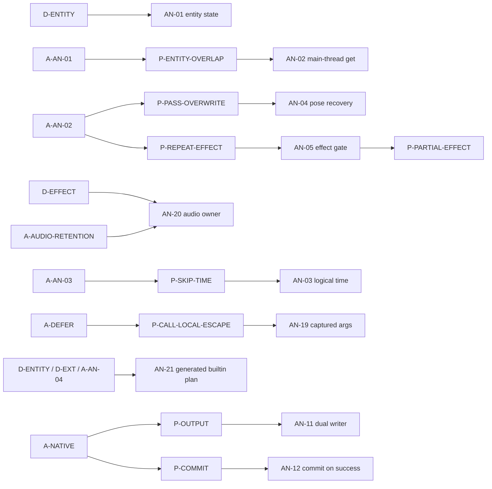

# 因果图与高扇出候选

本页维护 AN 内部关系的唯一登记；跨子系统关系见[跨子系统关系](../governance/cross-subsystem-relations.md)，全局 R/D 排名见[全局高扇出候选](../governance/global-fanout.md)。

## 局部因果图

## 高扇出候选

| 候选 | 影响的本地机制 | 局部解释 |
|---|---|---|
| `A-AN-02` | AN-04、05 | 多 pass 共用动画历史，同时引发姿态污染和动作重复两类风险 |
| `A-AUDIO-RETENTION` | AN-20 | 前缀缓存要求按消费缺口按需恢复、每轮播放独立持有 decoder，并在取消后封口副作用 |
| `A-NATIVE` | AN-11、12 | 跨语言输出既需要适配不同的宿主 consumer，也要保证失败前不提交顶点 |
| `D-FAIL`、`D-EXT`、`D-HOST` | AN-10、12 | 可选联动与宿主输出各有独立的失败边界，不能合并为同一套 fallback |
| `D-SOUND`、`D-EFFECT` | AN-20 | 模型声音复用主时间线的动作触发资格，并由单一完整后端统一负责播放与结束处理 |
| `D-LOOP`（扩展候选） | AN-02、03 | 主循环预算目标能解释优化方向，但不能证明原地异步和当前限频策略是唯一必需方案 |
| `H-BLEND` | AN-08 | 现存机制的存在属 Fact，但根理由仍是 Hypothesis，不计入 Fact 高扇出排名 |

## 局部因果与删除边界

| 子图 | 派生负担与可改变前提 | 不随上游自动消失的义务 |
|---|---|---|
| `A-AN-01 → AN-02` 与 `A-AN-02 → AN-04/AN-05` | 原地异步求值带来串行与汇合负担，多 pass 共用历史带来姿态恢复负担。worker 发布依赖对应的 `get`，主线程生命周期已替代通用 runtime barrier，但局部绘制借用和独立编译交付仍然保留。 | 单实体隔离、动作次数、Ready lease 和 native 视图有效期各自独立；取消异步求值并不意味着可以删掉多 pass 保护或动作门禁。 |
| `D-CONTROLLER → AN-06` | Controller 解析缓存减少了共享查询，但引入了精确来源失效与无上限名称保留。删掉缓存即可消除这两项派生负担；桥接逻辑与缓存的必要性相互独立。 | 同名成功播放不重启、失败后可恢复、来源隔离以及共享资源关闭责任仍然成立。 |
| `AN-05 → P-PARTIAL-EFFECT` | 领域动作立即生效，但同一轮中的后续调用仍可能失败。 | 先前已执行的动作不会回滚；本地 sync 在源借用结束后才交付，严重退出时清除未交付载荷。具体阶段边界见[效果契约](../../architecture/animation/molang-runtime.md#invocation-与效果)。 |
| `A-DEFER → P-CALL-LOCAL-ESCAPE → AN-19` | 延后执行带来了参数快照与逆序排空负担；调整调度可以收缩参数留存窗口，但仍需保持既有动作语义。 | 实体隔离、捕获值语义以及模型切换或结束时的排空义务仍在；如果要改变可观察的执行顺序，必须回到产品与兼容边界重新裁决。 |

以上子图均来自下方本地关系表。AN-08 的根原因仍为假设，作品依据缺口见 [Q-06](open-questions.md#q-06)。

## Fact 因果关系

| From | Type | To | Basis |
|---|---|---|---|
| D-ENTITY | requires | AN-01 | AN-01 |
| A-AN-01 | creates | P-ENTITY-OVERLAP, P-LIVE-INPUT, P-LOOP-WAIT | AN-02；后两项目前尚无完整的解决机制 |
| P-ENTITY-OVERLAP | addresses | AN-02 | AN-02 |
| A-AN-02 | creates | P-PASS-OVERWRITE, P-REPEAT-EFFECT | AN-04 与 AN-05 |
| P-PASS-OVERWRITE | addresses | AN-04 | AN-04：按 context 分离输出并恢复姿态；第一人称初始数组与活跃属性分离，局部借用逐次 draw 结束 |
| P-REPEAT-EFFECT | addresses | AN-05 | AN-05 |
| D-EFFECT | requires | AN-05 | AN-05 |
| D-EFFECT | requires | AN-20 | AN-20：声音触发只能由具备动作资格的主时间线提交 |
| AN-05 | creates | P-PARTIAL-EFFECT | AN-05：领域动作立即生效，后续失败保留先前动作，不承诺跨系统回滚 |
| A-DEFER | creates | P-CALL-LOCAL-ESCAPE | AN-19：延后执行跨越了单次调用局部参数的寿命 |
| P-CALL-LOCAL-ESCAPE | addresses | AN-19 | AN-19：通过求值快照与逆序排空解决；Forge 实机排空时机尚待核验 |
| A-AN-03 | creates | P-SKIP-TIME | AN-03 |
| P-SKIP-TIME | addresses | AN-03 | AN-03 |
| D-CONTROLLER | requires | AN-06 | AN-06 |
| D-VANILLA-ACTION | requires | AN-06 | AN-06 |
| D-AN-FALLBACK | requires | AN-06 | AN-06 |
| A-AN-04 | requires | AN-09 | AN-09 |
| A-AN-04 | requires | AN-21 | AN-21：由声明 authority 统一生成单一 catalog、类型化适配器与 holder |
| D-EXT | requires | AN-10 | AN-10 |
| D-EXT | requires | AN-21 | AN-21：可选能力在静态计划中直接降级，不提前加载缺失类 |
| D-ENTITY | requires | AN-21 | AN-21：每实体的组件与 holder 及精确匹配的 `SubjectBinding` 相互隔离 |
| P-OUTPUT | addresses | AN-11 | AN-11：宿主 consumer 并不总是暴露可识别的连续顶点布局 |
| P-COMMIT | addresses | AN-12 | AN-12：防范 native 准备之后才发生的失败 |
| D-HOST | requires | AN-12 | AN-12 |

## 非因果关系与候选扩展

| From | Relation / Confidence | To | 含义 |
|---|---|---|---|
| AN-10 | depends / Fact | AN-09 | 当前反射产物协议依赖编译期生成器，但可选隔离义务有独立的产品来源 |
| AN-11 | preserves / Fact | D-OUTPUT | 产品要求不同输出路径语义等价，并不强制采用当前的双路径实现 |
| AN-02 | conflicts / Fact | D-LOOP | 跨调度阶段的 Future 等待与现有禁止主循环等待的条款冲突 |
| AN-03 | conformance-pending / Hypothesis | D-SAMPLE | 限频本身已获允许，但当前实现的整体表现与逻辑因果保持仍待验证 |
| H-BLEND | motivates / Hypothesis | AN-08 | 历史旋转混合问题是否仍属于受保护的作品语义尚无定论 |
