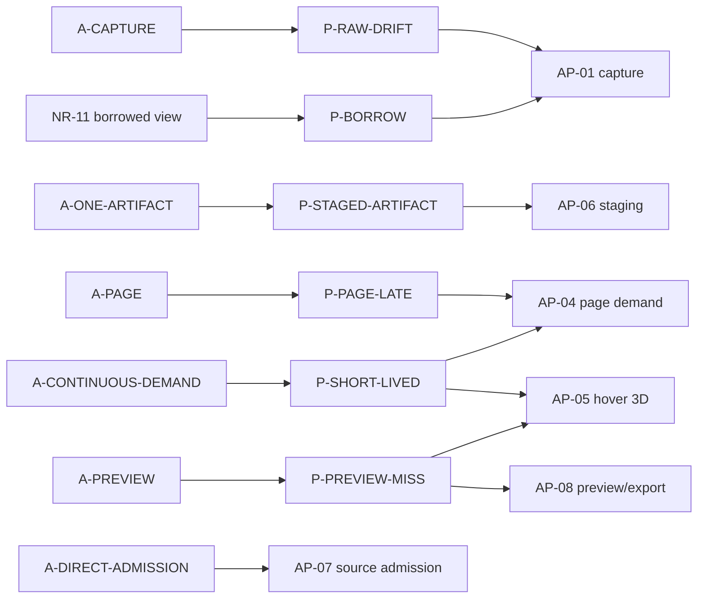

# 因果图与高扇出候选

本页维护 AP 内部关系的唯一登记；跨子系统关系见[跨子系统关系](../governance/cross-subsystem-relations.md)，全局 R/D 排名见[全局高扇出候选](../governance/global-fanout.md)。

## 局部因果图

## 高扇出候选

| 候选 | 影响的本地机制 | 局部解释 |
|---|---|---|
| `D-SOURCE` | AP-06、07、08 | 转换交付、direct 准入与独立 preview 和 export 各自保留独立 owner |
| `D-JOIN`、`D-CHUNKS`、`D-META`、`D-VERIFY` | AP-02、05 | 分层内容可用性约束本地与远端获取；模型卡片按资格准备 GUI，选择操作独立准备 FULL |
| `D-FREEZE` | AP-01、06、08 | 输入、staging 与 export 各自落实语义冻结 |
| `D-SOUND`、`D-MIGRATION` | AP-09 | Raw 与 legacy 通过同一当前音频 profile 交付，元数据与完整内容分阶段验证 |
| `A-CONTINUOUS-DEMAND` | AP-04、05 | 同一 Coordinator 为页面、hover、选择与实体维护各自独立的门槛和结束条件 |
| `A-PREVIEW`、`A-PREVIEW-CACHE` | AP-05、08 | 3D 探测与图片获取属于两个可分别替换的展示层选择 |
| `A-ARCHIVE` | AP-01 | Native 借用协议将“下次读取前必须复制”叠加为 capture 的额外约束 |

## 局部因果与删除边界

| 子图 | 附属机制及退出条件 | 仍有独立来源的义务 |
|---|---|---|
| `A-CAPTURE → P-RAW-DRIFT → AP-01`；`NR-11 → P-BORROW → AP-01` | 分阶段解析需要固定输入，archive 借用又要求及时复制，因此同一个 capture 同时承接两类约束。 | 即使把 archive 改为返回独立拷贝，也只消除了“下次读取前复制”的时间耦合，扫描与编译之间的来源一致性义务仍在。 |
| `A-ONE-ARTIFACT → P-STAGED-ARTIFACT → AP-06`；AP-06 依赖 AP-02 | 不同格式统一转为当前容器后，需要独立产物交接与可读性验证；调整交付表示可以减少 staging I/O。 | NR-13 的跨语言 payload 所有权、内容投影保真、MN-05 的存储提交和 MN-01 的目录发布各自有独立失败边界。 |
| `A-PAGE → P-PAGE-LATE → AP-04`；AP-04 依赖 MN-17 | 页面关闭不代表共享后台工作已经完成，因此必须撤回需求并妥善处置迟到结果。 | 即使更换页面加载策略，也不能关闭其他消费者的 Ready lease；独立 GUI 纹理与模型纹理的发布 owner 也仍然不同。 |
| `A-CONTINUOUS-DEMAND → P-SHORT-LIVED → AP-04/AP-05` | Coordinator 为页面、hover、选择和实体只保留当前意图及起点；取消连续门槛即可删除这些短期状态。 | 完整 Ready 及时交付、各流相互独立以及页面关闭时的清理义务仍然需要保持。 |
| `A-PREVIEW → P-PREVIEW-MISS → AP-05/AP-08` | 预览优先策略与独立 cache 分别承接展示缺失；取消 3D hover 可以缩减 AP-05，但无法删掉图片获取。 | 浏览不触发全量模型下载仍是硬约束；AP-08 的弱关联与 export，以及 AP-03 的 raw 输入策略也各自独立。 |
| `A-DIRECT-ADMISSION → AP-07`；`A-PREVIEW-CACHE → AP-08` | 调整来源政策或图片存储方案后，两项机制可分别替换。 | Schema 合法性、模型内容验证、作者图保留和用户来源只读不会随具体实现一并消失。 |

上图与删除边界均由下方本地关系表支撑，不把“转换 → 存储 → 目录 → 页面”的普通数据流当成因果链。AP-03 的策略效果与成本、AP-05 的选模体验收益仍缺少实证，低扇出不降低它们的记录价值。

## Fact 因果关系

| From | Type | To | Basis |
|---|---|---|---|
| D-JOIN | requires | AP-05 | AP-05：自动卡片最多做离线准备，符合资格的 hover 仍受页面准入约束 |
| D-VERIFY | requires | AP-02 | AP-02 |
| P-PAGE-LATE | addresses | AP-04 | AP-04 |
| D-FREEZE | requires | AP-01, AP-08 | AP-01 保证身份与产物消费同一份输入；AP-08 在 export 时冻结完整输出 |
| A-CAPTURE | creates | P-RAW-DRIFT | AP-01：分阶段解析之间，原始来源可能发生变化 |
| P-RAW-DRIFT | addresses | AP-01 | AP-01 |
| A-ONE-ARTIFACT | creates | P-STAGED-ARTIFACT | AP-06：转换过程成功不等于写出的当前容器可读 |
| P-STAGED-ARTIFACT | addresses | AP-06 | AP-06：通过 staging 与重开验证确认可读性 |
| D-FREEZE | requires | AP-06 | AP-06：交付物必须完整承接本次冻结语义 |
| D-MIGRATION | requires | AP-09 | AP-09：legacy 声音转换为当前 profile 后由 Java 复验 |
| A-IMAGE | creates | P-CODEC-FAIL | AP-03：raw 图片重编码可能失败 |
| P-CODEC-FAIL | addresses | AP-03 | AP-03：遇到可处理的 codec I/O 失败时保留原图 |
| A-PAGE | creates | P-PAGE-LATE | AP-04 |
| A-PREVIEW | creates | P-PREVIEW-MISS | AP-05 与 AP-08：离线缺失不污染后续 FULL 获取，图片可独立获取 |
| P-PREVIEW-MISS | addresses | AP-05, AP-08 | AP-05 与 AP-08 |
| A-DIRECT-ADMISSION | requires | AP-07 | AP-07：实际来源准入与 schema 合法性分层 |
| A-PREVIEW-CACHE | requires | AP-08 | AP-08：弱关联独立图片不回写模型容器 |
| NR-11 | creates | P-BORROW | NR-11 与 AP-01：后续读取可能覆盖前一次读取的借用缓冲 |
| P-BORROW | addresses | AP-01 | AP-01 |

## 非因果关系与候选扩展

| From | Relation / Confidence | To | 含义 |
|---|---|---|---|
| AP-07 | depends / Fact | AP-02 | 来源策略门禁建立在 schema 与内容验证之上，不把来源策略写进 reader |
