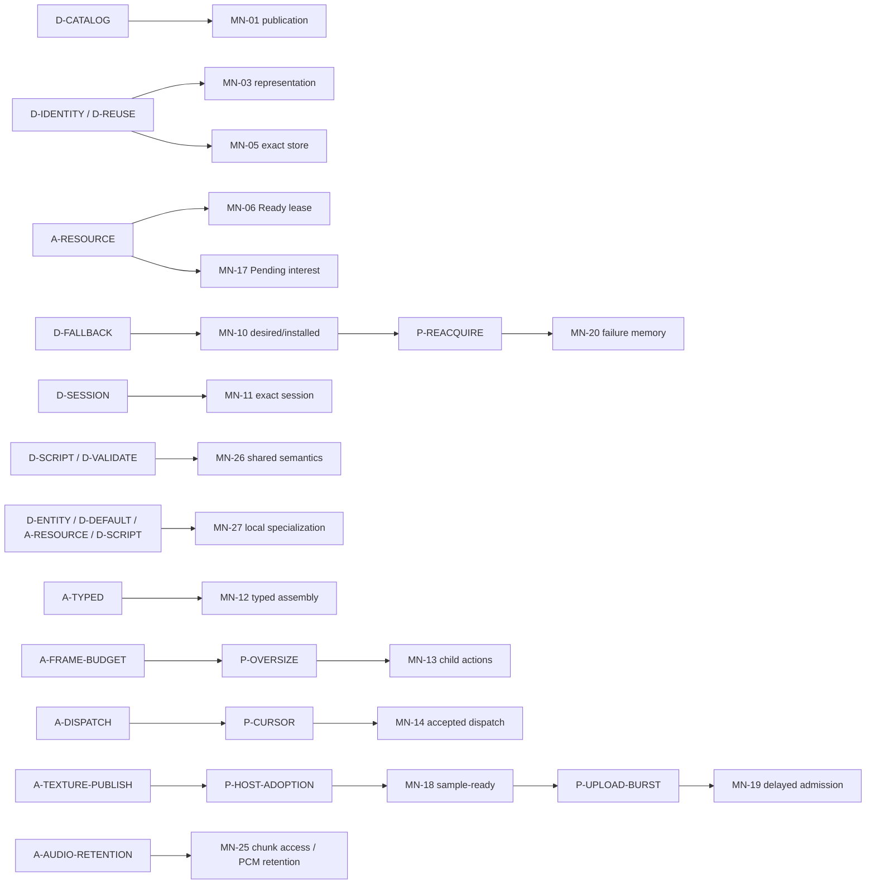

# 因果图与高扇出候选

本页是 MN 内部关系的唯一登记入口；跨子系统关系见[跨子系统关系](../governance/cross-subsystem-relations.md)，全局 R/D 排名见[全局高扇出候选](../governance/global-fanout.md)。

## 局部因果图

## 高扇出候选

| 候选 | 影响的本地机制 | 局部解释 |
|---|---|---|
| `D-CATALOG/D-HOLD/D-EXACT` | MN-01/05/06 | 完整目录、精确读取和已有使用保活属于三条不同的生命周期义务 |
| `D-IDENTITY/D-REUSE` | MN-03/05 | 同源替代规则与字节精确 cache 同时存在 |
| `D-JOIN/D-CHUNKS/D-META/D-VERIFY` | MN-02/12 | Catalog 分阶段可用与按类型组装共享同一按需获取根 |
| `A-RESOURCE` | MN-06/17 | Ready 可达性与 Pending 关注计数（interest）无法合并成单一引用计数 |
| `D-DEFAULT/D-FALLBACK/D-HOST-FALLBACK` | MN-08/10 | 必需的默认模型与运行期分类降级各自独立负责 |
| `A-TEXTURE-PUBLISH` | MN-18/19 | 宿主纹理完整接纳会给普通资源发布带来集中调度负担 |
| `D-CAPABILITY` | MN-12/22 | 按类型请求校验与物理文件系统路径边界分别约束远端输入 |
| `A-CONTINUOUS-DEMAND/A-FAILURE-MEMORY` | MN-10/20 | 当前选择、实体安装与精确失败记忆各自独立判断，资源进入 Ready 不代表已完成安装 |
| `A-AUDIO-RETENTION` | MN-25 | 完整 PCM 与首块 PCM 及 checkpoint 共用缓存；首块 token、活跃解码数据与缓存各自按生命周期计入预算 |

## 局部因果与删除边界

以下是本页关系表的摘要。沿 `→` 阅读原因与后果；跨机制的协作与依赖见下方的非因果关系表，不能据此把整组机制一并删除。

| 子图 | 可整体退出的条件 | 仍有独立来源的义务 |
|---|---|---|
| `A-RESOURCE → MN-17`（共享 Pending 工作 → 最后 interest 与迟到完成协调）；`A-RESOURCE → MN-06`（共享 Ready → 引用保活） | 只有不再共享待完成工作，才可能去掉 interest 聚合；只有改变已完成资源的 owner 方案，才可能替换可达性管理。 | 多消费者已取得的资源必须继续有效，取消关注不能直接等同于物理关闭；会话身份隔离仍由 MN-11 保证。 |
| `D-HOLD → MN-05`（文件型内容的后续读取按精确实例排序；已完成资源由 MN-06 保活） | 只有取消延迟读取，才可能删除 source-instance 状态。 | `direct` 原件的后续读取允许局部失败；但已开始读取的完整校验、用户来源的处置权保护以及缓存字节校验仍各自独立。 |
| `A-TEXTURE-PUBLISH → MN-18 → P-UPLOAD-BURST → MN-19`（宿主发布 → 渲染 owner 集中处理 → 延后接纳） | 只有宿主发布策略调整，或有了实测证据支持的新调度预算，才可收缩排队与等待期保护。 | GPU 与宿主线程亲和性、失败候选不污染 Ready 以及旧 lease 保活仍在；只改队列名称没有收益。 |
| `MN-10 → P-REACQUIRE → MN-20`（保留恢复机会 → 同条件重复请求 → 精确失败记忆） | 只有把失败资格统一在同一领域内表示，并证明不同请求和内容仍能正常恢复，才可合并。 | Flight 结束后必须退出；模型请求、target 内懒加载资源与预览缺失的失败边界各不相同，不能拼成一张全局永久失败表。 |
| `A-REMOTE-FILES → MN-22` | 只有不再写文件型缓存，才可能退出路径边界校验。 | 来源保护、完整发布和精确内容身份仍由各 owner 各自保持。 |
| `A-CONVERTED-CONSUMERS → MN-24` | 只有不再跨进程共享 `converted` 缓存，或改用能证明活跃使用的更轻量方案，才可退出登记与清理许可。 | 用户来源只读、精确对象校验和单次扫描的保留集合仍各自独立；该机制也不能扩大成所有缓存的统一清理方。 |

## Fact 因果关系

| From | Type | To | Basis |
|---|---|---|---|
| D-RELOAD | creates | P-INVENTORY | MN-01：运行期来源目录可变 |
| D-CATALOG | requires | MN-01 | MN-01 |
| P-INVENTORY | addresses | MN-01 | MN-01 |
| A-NOTIFY | requires | MN-02 | MN-02：事实提交与通知分发分离 |
| D-REUSE | requires | MN-03, MN-05 | MN-03/05 |
| D-CAPABILITY | requires | MN-12, MN-22 | 按类型请求校验与文件型缓存的物理落地路径约束 |
| D-HOLD | creates | P-SHARED | MN-06：已持有的资源使用需要跨目录退役继续存活 |
| D-HOLD | requires | MN-05 | 已验证的 `remote` 和 `converted` 精确目标遇到坏读或替换失败时不能破坏当前对象；`direct` 的后续读取允许局部失败 |
| A-RESOURCE | requires | MN-06, MN-17 | 已完成资源的可达性与未完成工作的关注计数是两个独立机制 |
| A-RESOURCE | requires | MN-27 | MN-27：请求、Pending 与 Ready、失败记录、缓存与实例共享同一套完整本地特化身份 |
| P-SHARED | addresses | MN-06 | MN-06 |
| A-TEXTURE-PUBLISH | creates | P-HOST-ADOPTION | MN-18：native 或解码成功不等于宿主纹理已经可采样 |
| P-HOST-ADOPTION | addresses | MN-18 | MN-18 |
| D-HOST | requires | MN-18 | MN-18：失败的候选纹理不能污染已发布表现 |
| MN-18 | creates | P-UPLOAD-BURST | MN-19：宿主纹理发布集中在渲染 owner 线程执行 |
| A-PUBLISH-BUDGET | requires | MN-19 | MN-19：按普通资源结束项条数做延迟调度是当前架构选择 |
| P-UPLOAD-BURST | addresses | MN-19 | MN-19（不代表当前 4/2 阈值是性能最优值） |
| A-CONVERTED-CONSUMERS | requires | MN-24 | MN-24：按 DATA 与版本范围登记跨进程活跃消费者，并控制短期清理许可 |
| D-SESSION | requires | MN-07, MN-11 | MN-07/11 |
| D-DEFAULT | requires | MN-08 | MN-08 |
| D-DEFAULT | requires | MN-27 | MN-27：内置默认模型共用静态声明计划，并保留完整本地产物身份 |
| A-DEFAULT-MEM | requires | MN-08 | MN-08：常驻内存的默认模型 |
| D-FALLBACK | requires | MN-08, MN-10 | MN-08/10 |
| D-HOST-FALLBACK | requires | MN-10 | MN-10 |
| D-RECOVER | requires | MN-20 | 模型请求与懒加载资源失败需要区分恢复条件与重复失败拦截 |
| MN-10 | creates | P-REACQUIRE | MN-20：保留恢复机会后，相同条件可能触发重复请求 |
| A-FAILURE-MEMORY | requires | MN-20 | 模型请求与懒加载资源的失败诊断需要脱离已结束的 Flight 留存 |
| P-REACQUIRE | addresses | MN-20 | MN-20 |
| D-SESSION-FAIL | requires | MN-11 | MN-11 |
| D-WIRE | requires | MN-11 | MN-11：只保留单条当前协议路径 |
| D-VALIDATE | requires | MN-12, MN-16, MN-26 | MN-12/16/26 |
| D-ACCESS | requires | MN-12, MN-31 | 请求资格校验与配置整体目录分类各自独立处理 |
| A-TYPED | requires | MN-12 | MN-12：各业务局部负责方自行承担消息组装 |
| P-ASSEMBLY | addresses | MN-12 | MN-12 |
| A-FRAME-BUDGET | creates | P-OVERSIZE | MN-13：完整 descriptor 可能超过单帧预算 |
| P-OVERSIZE | addresses | MN-13 | MN-13 |
| A-DISPATCH | creates | P-CURSOR | MN-14：需要已接纳数据源、发送游标（cursor）与背压控制 |
| P-CURSOR | addresses | MN-14 | MN-14 |
| D-ADMISSION | requires | MN-14 | MN-14：接纳数据源时即固定授权结果 |
| A-REPORT | requires | MN-16 | MN-16：当前上报协议的真实基线与尽力而为的发送机会 |
| D-SERVER | creates | P-REPORT | MN-16 |
| P-REPORT | addresses | MN-16 | MN-16 |
| D-PLAYER | requires | MN-16 | MN-16 |
| D-TRACKING | requires | MN-16 | MN-16 |
| D-SCRIPT | requires | MN-16, MN-26, MN-29 | 当前表现、瞬时事件与 UUID 持久化事实各自独立维护 |
| D-SCRIPT | requires | MN-27 | MN-27：本地产物身份与跨端共享语义相互分离 |
| D-ENTITY | requires | MN-27 | MN-27：所有主体共用冻结后的声明事实，AOT 与解释执行分别绑定精确的主体和代次 |
| A-REMOTE-FILES | creates | P-PHYSICAL-PATH | MN-22：所有文件型缓存的符号链接和目录替换都会影响实际落盘位置 |
| P-PHYSICAL-PATH | addresses | MN-22 | MN-22 |
| A-SQLITE | requires | MN-28 | 固定业务能力、epoch 与 revision 校验、私有资源复用、短事务与显式关闭 |
| A-BUFFER | requires | MN-30 | 有界逻辑顺序、覆盖合并与独立的逐项提交状态 |
| A-STARTUP-WARMUP | requires | MN-32 | 可选的无玩家启动预热需要汇合偏好与目录、单次提交及短期 lease 保留 |

## 非因果关系与候选扩展

| From | Relation / Confidence | To | 含义 |
|---|---|---|---|
| MN-17 | coordinates / Fact | MN-11, MN-12 | 最后一个关注方退出时，向对应的传输负责方请求取消 |
| MN-17 | depends / Fact | MN-18 | 成功的候选资源必须先通过宿主纹理发布，才会进入 Ready |
| MN-19 | depends / Fact | MN-17, MN-18 | 排队等待期间依赖对应的 Flight 有效性检查，出队后仍走同一套 Ready 门禁 |
| MN-10 | depends / Fact | MN-06, MN-17 | 保留旧 Ready 与等待或取消新候选，属于两种不同的资源使用方式 |
| MN-20 | coordinates / Fact | MN-10, MN-17 | 失败记忆只记录重试资格，不延长 Flight 或传输的生命周期 |
| MN-05 | depends / Fact | MN-22 | `remote` 文件分支的读写受固定区域与路径校验约束，坏读不赋予删除当前目标文件的权限 |
| MN-06 | depends / Fact | MN-05 | 文件型内容保活仍依赖精确读取实例；Ready 强引用不保证后续读取 `direct` 原件一定成功 |
| MN-24 | coordinates / Fact | MN-01, MN-05 | CACHE 根目录在交付给消费者前完成登记，Catalog 提供完整范围和持久来源事实。显式受控关闭时，先停止 Catalog 以及客户端和服务端 runtime，再排空根内任务并释放消费者资格；JVM 退出则由操作系统回收登记占用 |
| MN-02 | independent-authority / Fact | MN-16 | 目录集合（Collection）不拥有玩家选择状态 |
| MN-26 | depends / Fact | MN-11 | 当前连接与会话校验先于表达式授权和转发执行 |
| MN-26 | independent-authority / Fact | MN-16 | `ConfigAction` 保持独立的语义身份；`sync` 仅按当前选择意图转发，不写入恢复状态 |
| MN-29 | depends / Fact | MN-28 | 依赖按序读取偏好、纯查询句柄、整值写入与原子首填能力 |
| MN-30 | depends / Fact | MN-28 | 写缓冲消费真实的逐项提交与交付结果，用于限制原快照的无效重放 |
| MN-16 | coordinates / Fact | MN-29 | 本地 producer 与原选择操作共享恢复资格，初值和持久化资格在本地提交时交接；查询失败的 scope 仍可上报状态但不落盘，且持久化完成不会反向驱动 runtime |
| MN-32 | depends / Fact | MN-01, MN-06, MN-17, MN-27, MN-29, MN-30 | 直接消费本地目录发布与顺序偏好查询，按普通 FULL 流程取得独立 lease；不接管目录、存储或资源的生命周期管理 |
