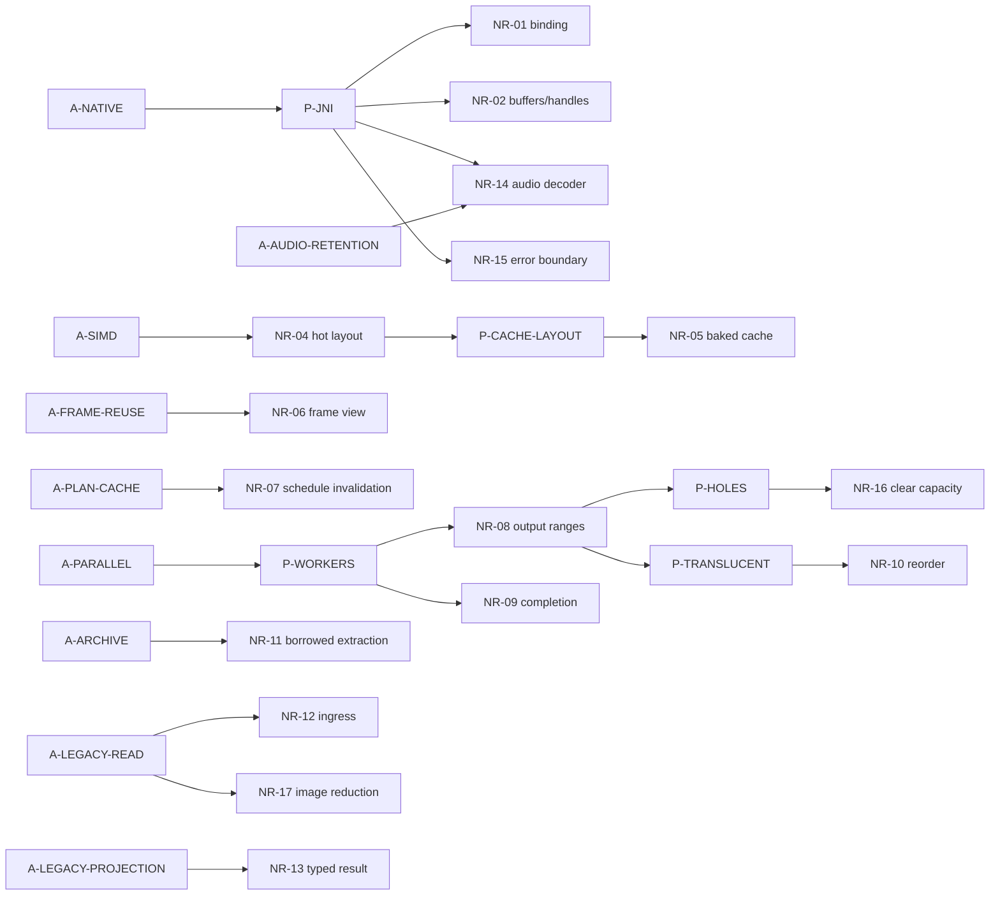

# 因果图与高扇出候选

本页是 NR 内部关系的唯一登记入口；跨子系统关系见[跨子系统关系](../governance/cross-subsystem-relations.md)，全局 R/D 排名见[全局高扇出候选](../governance/global-fanout.md)。

## 局部因果图

## 高扇出候选

| 候选 | 影响的本地机制 | 局部解释 |
|---|---|---|
| `A-AUDIO-RETENTION` | NR-14 | 前缀复用引入了状态深拷贝、checkpoint 所有权与接纳，以及恢复后的内存计价 |
| `A-NATIVE` | NR-01/02/14/15 | 入口绑定、地址与所有权交接、音频解码器和错误收口是并列的 ABI 义务 |
| `A-PARALLEL` | NR-08/09/10/16 | 固定输出区间与单次 draw 汇合进一步派生了空洞清理与透明重排 |
| `A-SIMD` | NR-04/05 | 依赖 SIMD 宽度的热布局要求烘焙缓存按 profile 隔离 |
| `A-LEGACY-READ` | NR-12/17 | 有界输入读取与图片峰值表示归约承担不同的失败边界 |
| `A-ONE-ARTIFACT/D-MIGRATION` | NR-13 | 单向迁移只保留当前格式的 payload 和统一的整体结果所有权 |
| `A-ARCHIVE` | NR-11（并影响 AP-01） | 借用提取缓存试图减少内存分配，但换来了跨调用的时间耦合 |

## 局部因果与删除边界

| 子图 | 附属关系与可消失前提 | 保留的独立义务与成本 |
|---|---|---|
| `A-NATIVE → P-JNI → NR-01/02/15` | 同一跨语言边界分别派生出入口绑定、内存交接和错误收口，三者属于并列义务。 | 统一 descriptor 不会消除地址寿命或异常隔离义务；即使渲染输出桥退出，codec、archive 和 legacy 等消费者仍需要这套边界。 |
| `A-SIMD → NR-04 → P-CACHE-LAYOUT → NR-05` | 依赖 SIMD 能力的布局导致派生结果不能跨宽度复用；改用与宽度无关的标准存储表示可减少缓存按 profile 分裂。 | 读取期重排与冷加载成本可能上升，且烘焙正确性、精确输入校验与资源限制仍需保留。 |
| `A-PARALLEL → NR-08 → P-HOLES → NR-16` | 预留固定区间却按整段容量提交，才需要清理未写入槽位；改为只提交紧凑的实际写入范围后，这项补偿才可退出。 | 输出不重叠、仅在成功后提交以及 NR-10 的透明排序仍有独立来源；引入紧凑合并或前缀和（prefix-sum）也可能带来新的同步开销。 |
| `NR-08 → P-TRANSLUCENT → NR-10 → P-DRAW-REENTRY` | 分散的透明输出需要整体暂存和重排，而全局 scratch 缓冲区又要求调用串行。 | 当前设计以“调用串行”为前提，并不存在通用的重入保护；若将来需要并发 draw，必须先核验 scratch 与 NR-09 executor 的边界。 |
| `A-FRAME-REUSE → NR-06`；`A-PLAN-CACHE → NR-07` | 原地帧 view 的有效期约束与可见工作集缓存失效是两项独立选择，不能混为一谈压成“帧状态缓存”。 | 改为每帧重算 schedule 可以去掉 NR-07 缓存，但仍无法让旧 view 跨 `extract` 存活；仅更新姿势（pose-only）和等长成员替换仍须分别验证。 |
| `A-ARCHIVE → NR-11 → P-BORROW → AP-01` | 借用提取缓存衍生了 Java 侧在下次读取前必须复制的时序约束。 | 内存复制可以在语言边界两侧迁移，但不会自动消失；7z solid-block 的解压成本与分阶段输入冻结也仍各自保留。 |
| `A-LEGACY-READ → P-LEGACY-IMAGE → NR-17` | 完整模型解码会让原始图片表示跨越整个解析生命周期；在解码期提前按用途转换并复用已编码结果，可压低峰值内存并避免重复编码。 | NR-12 的输入与明文边界、NR-13 的类型化结果所有权以及 AP-03 的原始转换失败回退，都各有独立的删除条件。 |

本地关系全集见下表，跨域关系统一维护在[跨子系统关系](../governance/cross-subsystem-relations.md)。Allocator 与 TLS 相关的 NR-03 仍单独保留为 Uncertain；legacy 的输入与明文边界、图片表示归约及结果所有权分属读取、峰值内存和交付失败三条边界，不能因为“都属于导入”就合并成一个节点。

## Fact 因果关系

| From | Type | To | Basis |
|---|---|---|---|
| A-IMAGE | requires | NR-17 | NR-17：legacy 图片按用途准备目标编码并校验交付 |
| C-JNI | requires | NR-15 | NR-15 |
| P-JNI | addresses | NR-01, NR-02, NR-14, NR-15 | 入口绑定、地址协议、音频解码器 handle 与错误边界分别计数 |
| A-SIMD | creates | P-HOT-LAYOUT | NR-04 |
| P-HOT-LAYOUT | addresses | NR-04 | NR-04 |
| NR-04 | creates | P-CACHE-LAYOUT | NR-04/05：按 SIMD 能力生成的烘焙产物不可跨宽度混用 |
| P-CACHE-LAYOUT | addresses | NR-05 | NR-05 |
| A-BAKED-CACHE | requires | NR-05 | NR-05 |
| A-FRAME-REUSE | creates | P-FRAME-VIEW | NR-06：原地覆盖会使旧 view 失效 |
| P-FRAME-VIEW | addresses | NR-06 | NR-06 |
| A-PLAN-CACHE | creates | P-PLAN-STALE | NR-07：长度相同的可见骨骼序列也可能发生内容替换 |
| P-PLAN-STALE | addresses | NR-07 | NR-07 |
| A-PARALLEL | creates | P-WORKERS | NR-08/09 |
| P-WORKERS | addresses | NR-08, NR-09 | 输出区间隔离与依赖完成同步分别计数 |
| NR-08 | creates | P-HOLES, P-TRANSLUCENT | NR-16/10 |
| P-HOLES | addresses | NR-16 | 只服务于“按预留容量提交”的策略 |
| P-TRANSLUCENT | addresses | NR-10 | NR-10：分散的并行透明输出需要整体重排 |
| D-TRANSPARENCY | requires | NR-10 | NR-10：透明排序义务有独立的产品来源 |
| NR-10 | creates | P-DRAW-REENTRY | 全局透明 scratch 不可重入；当前依赖串行调用前提，未提供通用重入保护 |
| A-ARCHIVE | requires | NR-11 | NR-11 |
| A-LEGACY-READ | creates | P-SOURCE-READ | NR-12：Java 完整读取可能访问失败或出现短读，native 精确结尾校验会拒绝不完整输入 |
| P-SOURCE-READ | addresses | NR-12 | NR-12 |
| A-LEGACY-READ | creates | P-LEGACY-IMAGE | NR-17：完整模型解码可能跨剩余解析周期保留原始图片表示并重复编码 |
| P-LEGACY-IMAGE | addresses | NR-17 | NR-17 |
| A-LEGACY-PROJECTION | creates | P-LEGACY-RESULT | NR-13 |
| P-LEGACY-RESULT | addresses | NR-13 | NR-13 |
| A-ONE-ARTIFACT | requires | NR-13 | NR-13 |
| D-MIGRATION | requires | NR-13 | NR-13 |

## 非因果关系与候选扩展

| From | Relation / Confidence | To | 含义 |
|---|---|---|---|
| NR-09 | conflicts / Inference | D-LOOP | 等待行为本身是 Fact；同次 draw 内的 fork/join 是否落在该条款约束内待 Q-01 确认 |
| H-ALLOCATOR | motivates / Hypothesis | NR-03 | 当前 allocator 与 TLS 故障前提尚待复现 |
