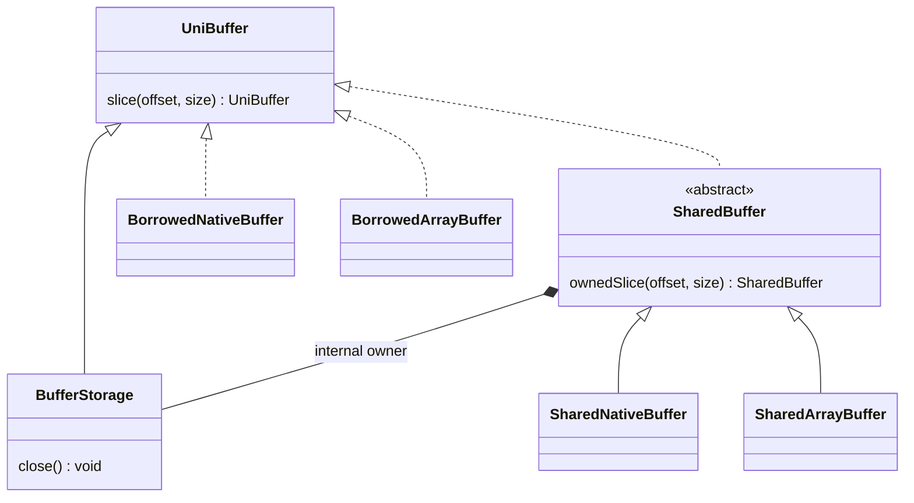

# 基建使用指南

本页是[实现指南](implementation.md#基建复用)的能力参考手册，列出项目内推荐复用的通用基础设施与使用契约。`com.elfmcys.ysm.util` 包含历史工具类，新代码仅以本文列出的入口及对应领域门面为首选。

## 主题索引

| 主题 | 内容 | 首选入口 |
|---|---|---|
| [Buffer 与所有权](#buffer-与所有权) | 数组与 native 字节访问、切片、复制、文件映射和跨存储拷贝 | `UniBuffer`、`ArrayBuffer`、`NativeBuffer`、`UniBufferIO` |
| [生命周期与构造回滚](#生命周期与构造回滚) | Cleaner 默认回收、固定 owner 的及时关闭与多资源构造回滚 | `CleanerUtil`、`try`-with-resources、`ScopeGuard`、`ResourceTransaction` |
| [JNI 与 native 能力](#jni-与-native-能力) | runtime 初始化、调用期借用、移交所有权的输出与带类型 handle | `NativeLibUtil`、`NativeRuntime`、`BufferArgument`、`NativeObject` |
| [Protobuf 字节适配](#protobuf-字节适配) | QuickBuffers 序列化、基于数组 buffer 的读写流与只读比较 | `ProtoUtil`、`ProtoBytes` |
| [扩展兼容基建](#扩展兼容基建) | 编译期兼容性 checker 与运行时事件处理器自动注册 | `@YsmExtension`、`@YsmEventHandler` |
| [Molang 扩展接纳](#molang-扩展接纳) | 可选统一 view、即时领域动作与延迟效果载荷 | `MolangFunction`、`MolangContextView<E>`、`MolangInputs` |
| [并发与执行边界](#并发与执行边界) | 领域 owner、背压、shutdown 与宿主线程调度约束 | 领域 executor、`ThreadScheduling.entry`、Minecraft 与 Forge 调度入口 |
| [数据库执行](../architecture/model-management/storage/overview.md#数据库执行) | 业务对象串行、有限排队、取消、提交与交付的区分以及资源关闭 | `DatabaseWork`、`NativeCacheCatalog`、`NativeCacheRemote`、`NativeBakeIndex`、`NativeFileIdAllocator`、`NativePlayerData`、`NativeCoordination`、`StorageProbe` |
| [启动功能验证](../tools/startup_observation/run_functional.py) | 在隔离 Forge 世界中验证真实消费与必需资源 I/O 失败，保留输入身份、原始日志和独立断言 | `extract_inventory.py` 清点独立输入，`JfrStartupExtract.java` 提取原始 JFR；overlay 安装在隔离源码的 `ClientStartup`；`REQUIRED_READY` 包含 Catalog activation 的短接纳，可与普通扫描重叠 |
| [第一人称验证输入](../tools/first_person_observation/README.md) | 同源 raw 与 protobuf 几何、局部矩阵独立期望、动作和工作量输入 | `generate_fixtures.py`；由定向测试核对输入一致性与真实 JNI 接纳 |
| [持续性能基建](../tools/benchmark/README.md) | 长期 JMH source set、真实 native 提取与输出工作量以及独立 fork 对照 | `benchmarkClasses`、`benchmark`、`prepareBenchmark` |

## Buffer 与所有权

项目内部传递连续字节块时，优先使用 `UniBuffer` 族。只有与要求特定 Java 类型的外部系统交互时，才在适配边界使用 `byte[]` 或 NIO `ByteBuffer`，不要让这些原生表示取代项目内的所有权契约。

创建新 buffer 时，如果主要是 Java 侧连续执行小块读写（例如 Protobuf 编解码），倾向选用 `ArrayBuffer`；如果是大块数据读写或主要由 native 侧读写，倾向选用 `NativeBuffer`。这只是创建时的存储倾向：如果手头已有的 `UniBuffer` 已经满足消费方契约，直接使用即可，不要为了迎合存储倾向而做无谓的拷贝和类型转换。

`UniBuffer` 的最大容量为 256 MiB，只表达数据访问和范围，不提供关闭权。体系中用两个正交维度区分类型：`NativeBuffer` 与 `ArrayBuffer` 区分底层存储表示；`BufferStorage`、`SharedBuffer` 与借用切片区分生命周期。

`BufferStorage` 由固定 owner 显式关闭，不注册 Cleaner，也不维护引用计数或关闭状态标记。`SharedBuffer` 是封装 Cleaner 生命周期的抽象基类，子类 `SharedNativeBuffer` 与 `SharedArrayBuffer` 各自负责对应存储表示的访问和切片。源自同一次内存分配的所有共享视图共用同一个内部 owner，该 owner 只注册一次 Cleaner，各消费方只需持有或释放普通强引用，因此 GC buffer 不提供 `close()` 或 `clean()`。选用 GC buffer 可以免去跨消费方的关闭协调，代价是物理内存释放可能滞后。



| 入口 | 契约 |
|---|---|
| `ArrayBuffer.allocate` / `NativeBuffer.allocate` | 创建 `ArrayStorage` 或 `NativeStorage`，由固定 owner 显式关闭 |
| `NativeBuffer.mapFile` | 创建只读文件映射 Storage，固定 owner 关闭时解除映射 |
| `move` | 接管传入的底层存储；调用方移交后不得再负责释放 |
| `borrow` / `slice(offset, size)` | 始终返回借用视图；无关闭权，也不延长来源的有效窗口 |
| `SharedBuffer.ownedSlice(offset, size)` | 返回保留共同 GC owner 的切片；不复制字节，也不新增 Cleaner |
| `SharedNativeBuffer.adopt` / `SharedArrayBuffer.adopt` | 接管整个 Storage 的所有权；即使接管失败也负责回收，原 owner 不得再关闭或访问该 Storage |
| `SharedNativeBuffer.allocate` / `SharedArrayBuffer.allocate` | 创建由 Cleaner 回收的 GC buffer |
| `SharedNativeBuffer.copyOf` / `SharedArrayBuffer.copyOf` | 将输入复制为独立的 GC buffer，用于跨窗口持有、转换存储表示或隔离可变输入 |
| `SharedBuffer.copyOf` | 保持输入原有的存储表示，复制为独立的 GC buffer |
| `share()` / `shareNative()` / `shareArray()` | 若输入已是匹配存储表示的 `SharedBuffer` 则直接返回自身，否则复制当前范围为 GC buffer；`share()` 保持原表示，不转移 Storage 关闭权，也不保证内容隔离 |
| `copy()` | 复制为独立 Storage，由接收方显式关闭或交由 GC wrapper 接管 |
| `copy(offset, size)` | 复制指定范围为独立 Storage，并在复制完成后对原 owner 执行 reachability fence |
| `copyNative()` / `copyArray()` | 复制为指定存储表示的独立 Storage |
| `nio()` / `array()` / `ptr()` | 仅派生访问视图或裸地址，不延长 owner 生命周期 |
| `UniBufferIO.copy` / `equals` | 统一处理数组与 native buffer 的各种组合并校验范围；业务代码不要手写类型分支和裸地址访问 |

`BorrowedNativeBuffer` 保存有界地址与 anchor，`BorrowedArrayBuffer` 保存数组范围与 anchor。Anchor 只保留来源存储或宿主引用，无法阻止显式关闭、扩容、归还对象池或内容被覆写。从 GC buffer 借用时，anchor 只指向内部 Storage 而不会保活 GC owner，因此调用方必须另行保活原 GC buffer；借用池化数组时，单靠持有数组引用也不足以阻止数组被归还池中。连续借用切片始终复用同一个 anchor，不会叠成长父切片链。

即使对 GC buffer 调用 `slice()`，返回的依然只是借用视图。如果需要在更长的作用域里持有切片，已知来源是 GC buffer 时应调用 `ownedSlice()`；其他来源则应复制一份，或由固定 owner 覆盖整个使用期。Storage 的关闭是一次性契约，访问方法不检查是否已关闭，调用方必须自行避免重复关闭、关闭后访问以及并发的关闭与使用。

`@Owned`、`@Borrowed` 和 `@Aligned` 仅用于代码审查时的契约标注，没有运行时检查。拿到 owning Storage 后，要么指定唯一的固定 owner，要么把整个 Storage 交给 GC wrapper，不要把关闭权分发给多个消费方。

从 owner 提取出 `ByteBuffer`、数组或裸指针后准备进入 JNI 或 Unsafe 调用时，必须在 `finally` 块中对原 owner 调用 `Reference.reachabilityFence`。Fence 只保证同步调用期间对象可达，不能解决并发关闭与访问竞态。完整的跨语言内存约束见[JNI 与内存](../architecture/native-runtime/implementation/jni-and-memory.md)。

当只读字节块已经准备完毕、需要交给多个消费方共享时，优先返回 `SharedBuffer`：生产方将最终 Storage 直接交给 `adopt`，各消费方共用同一 buffer，需要修改时再自行复制。此时领域对象的 `close()` 仍会撤销使用资格、归还配额并清掉自身引用，但不会回收已经交付出去的字节。可变构建过程与固定作用域内的 I/O 继续使用 `BufferStorage`。

`Image.adopt` 接管 Storage，`Image.data()` 返回对应的 GC buffer，`Image.share()` 共享同一底层数据。调用 `Image.close()` 只撤销当前 `Image` 实例的引用，不影响其他共享该数据的 `Image` 实例和已经交付出去的 GC buffer。

## 生命周期与构造回滚

何时用 Cleaner、何时用显式关闭的设计原则见[设计指南](design.md#java-资源选择)。

| 入口 | 契约 |
|---|---|
| `try`-with-resources | 唯一最终负责方已确定且需要及时释放时使用，按声明逆序关闭 |
| `com.elfmcys.ysm.util.Closeable` | 不抛出受检异常的 `AutoCloseable`，适合项目内的确定性关闭协议 |
| `ScopeGuard<T>` | 构造期间暂存单个固定 owner 的 `AutoCloseable`：中途失败自动关闭，调用 `release()` 后将所有权移交给长期 owner |
| `ResourceTransaction` | 构造多个固定 owner 资源时按获取顺序调用 `own()`：未调用 `commit()` 则逆序回滚，调用 `commit()` 后整体移交 |
| `CleanerUtil` | owner 类型注册默认回收动作的统一入口；业务代码不直接操作 `Cleaner` |
| `NativeObject` | 通用的不透明 native handle 持有者：`get()` 拒绝已关闭对象，Cleaner 与允许的显式关闭汇合到同一次 destroy |
| `NativeCancellation` | 通用单向取消标记：同步 `borrow` 阻止 handle 释放，`close` 封口并等待所有借用退出；见[协作取消契约](../architecture/native-runtime/overview.md#协作取消) |

接管新返回的原始不透明 native handle 时，使用 `NativeObject.adopt` 并传入接受其单次释放状态的 wrapper factory。该 factory 必须在获取 handle 之前就已准备好，且在对象构造完成前不得对外暴露 owner。`adopt` 负责覆盖 wrapper 分配、构造和 Cleaner 注册阶段的所有失败，全部回收到同一个 destroy 状态；后续如果外层载体构造失败，则直接关闭已经建好的 wrapper。不要直接把原始 handle 传给构造器，因为那样无法覆盖进入构造器之前的对象分配失败。

接管移交所有权的 direct buffer 输出时，使用 `NativeHeapBuffer.adopt`：它只接收与 native allocator 配套的基址视图，成功后交付 Storage；接管失败时自动释放尚未交付的 native 内存。不要拿该入口去接管任意 direct slice 或其他 allocator 分配的地址。如果希望转交 GC 管理，再调用 `SharedNativeBuffer.adopt` 消费该 Storage；GC owner 构造或 Cleaner 注册失败时同样应保证内存被回收。

`ResourceTransaction` 回滚时会抑制各个资源的关闭异常，因此只适合“清理失败不能掩盖原始构造失败”的场景。如果关闭失败本身需要反映到业务结果或诊断日志中，应由具体 owner 显式处理。

注册给 Cleaner 的清理动作及其参数绝不能强引用被注册对象，否则对象永远无法变为 phantom reachable。既支持显式关闭又挂有 Cleaner 的资源，必须让两者共享同一个仅执行一次的原子状态。对绑定特定线程的宿主资源，Cleaner 动作只能把销毁任务排入目标线程，不能在 Cleaner 线程里直接销毁宿主对象。模型资源的归属与清理责任见[所有权与生命周期](../architecture/model-management/client-resources/implementation/resource-ownership.md)。

```java
try (var resources = new ResourceTransaction()) {
    var model = resources.own(loadModel());
    var texture = resources.own(loadTexture(model));
    var target = new RenderTarget(model, texture);
    resources.commit();
    return target;
}
```

`commit()` 只表示这些资源已经被返回对象或其他明确的 owner 正式接管；在没有后继 owner 的情况下，绝不能用 `commit()` 跳过关闭。

## JNI 与 native 能力

生产启动阶段先通过 `NativeLibUtil.load()` 选出当前平台对应的动态库，再由 `NativeRuntime.load()` 检查 native ABI 符号并完成 JNI 注册；构建工具和测试直接复用后者。`NativeRuntime.initialize()` 是一次性配置协商，重复调用必须传入完全相同的 Java 配置。业务代码不得自行调用 `System.load`、重复初始化，或另立一套 native 可用性状态。

默认配置通过 `NativeRuntime.deviceQuality()` 消费一次设备分档结果，相关配置项共享同一结果；如果 native 不可用、入口缺失或返回未知值，统一采用保守默认，不再重新探测。跨语言编码与职责见[设备配置默认](../architecture/native-runtime/implementation/runtime-capabilities.md#设备配置默认)。

`BufferArgument.packInput()` 将 `UniBuffer` 打包为单次同步 JNI 调用所需的参数对象和标志位，既不创建持久 handle，也不延长底层存储的生命周期。`unpackOutput()` 返回移交所有权的 Storage，由接收方显式关闭或移交 GC wrapper。普通业务代码应优先调用强类型的 native 门面，不要直接操作 `BufferArgument`：

| 能力 | Java 门面 |
|---|---|
| hash 与压缩 | `Blake3`、`Zstd` |
| 图片解码与编码 | `Image`、`ImageEncoder` |
| 归档读取 | `NativeArchive.open` |
| 烘焙与 CPU 渲染 | `NativeBakedModel`、`NativeModelState`、`NativeRenderer` |
| 历史格式导入 | `NativeLegacyImporter` |
| 音频规范化与增量解码 | `AudioNormalizer.normalize`、`OpusDecoder.create` |

如果现有门面缺少所需操作，应扩展对应的能力门面和 native 入口，不要在业务类里私自新增旁路 `native` 方法。JNI 侧返回的回退值必须由 Java wrapper 显式解释，不能把 `false`、`null` 或默认标量直接当成有效的业务结果。能力边界与失败处理见[Native 运行边界](../architecture/native-runtime/implementation/runtime-capabilities.md)。

## Protobuf 字节适配

Java 内部直接共享不可变的生成 message 对象，只在跨 JNI、文件持久化或自定义网络帧边界时，才序列化为明确拥有所有权的字节块。Schema 与 wire 语义由[独立标准](../standards/README.md)定义，以下入口仅负责 Java 侧的字节表示适配：

| 入口 | 契约 |
|---|---|
| `ProtoUtil.sink(ArrayBuffer)` | 在现有数组范围上建立 QuickBuffers 写入目标；buffer 必须覆盖整个写入期且容量足够 |
| `ProtoUtil.source(UniBuffer)` | 直接借用数组或 native 范围建立 QuickBuffers 读取源，不转换存储表示；调用方负责在解析期间保活 owner，并在 `finally` 中调用 `Reference.reachabilityFence` |
| `ProtoUtil.serializeToArray(message)` | 按精确序列化长度分配并返回独立 `byte[]` |
| `ProtoUtil.serializeToBuffer(message)` | 返回移交所有权的 `ArrayStorage`；写入中途失败会自动关闭该 Storage |
| `ProtoBytes.copy(ByteBuffer)` | 复制当前 remaining 范围内的字节，不推进原 buffer 的游标 |
| `ProtoBytes.equals(...)` | 比较当前 remaining 范围内的字节，不推进原 buffer 的游标 |

JNI 边界不暴露 QuickBuffers 的 message、builder、解析游标或 allocator。需要把 Protobuf 数据交给 native 消费时，先用 `ProtoUtil` 序列化出拥有所有权的字节块，再按 `UniBuffer` 契约在同步调用期间借用给 JNI。

## 扩展兼容基建

第三方模组引用 YSM 符号时，用 `@YsmExtension` 声明兼容检查入口；需要自动注册 YSM 事件处理器时，用 `@YsmEventHandler`。同一个 YSM 主制品既作为编译依赖也作为 `annotationProcessor`，由 `ExtensionCompatibilityProcessor` 生成不直接链接 YSM 的启动期 checker。

不要自行复制 checker 生成、Forge 扫描元数据发现或“先检查再加载”的反射流程。接入方式、检测范围、状态语义与限制统一见[扩展模组兼容性检测](../extension-compatibility.md)。这些注解目前还不构成稳定的公共 API 承诺。

## Molang 扩展接纳

内建函数与扩展 API 的作者共用[声明签名与值契约](../architecture/animation/molang-declarations.md)。查询与动作的数据准备归各自领域 owner，按需注入统一 view；效果申请、提交许可与借用窗口见[公共业务 view](../architecture/animation/molang-declarations.md#公共业务-view)，语言级数学函数见[数学 intrinsic](../architecture/animation/molang-declarations.md#数学-intrinsic)。

扩展发现、依赖检查、`auto` 与 `manual` 接纳资格以及类级冻结规则见[扩展接入](../architecture/integration/implementation/extension-loading.md#扩展兼容检查与注册)；对外注解处理器打包与手动提交方式见[兼容检测](../extension-compatibility.md#molang-声明)。表达式与目标主体的绑定、调用入口与工厂见[Molang runtime](../architecture/animation/implementation/molang-runtime.md#binding-与-invocation)。

## 并发与执行边界

异步执行的设计约束见[设计指南](design.md#java-执行边界)。

`ResponsiveExecutor` 是进程级的固定容量守护线程池，线程优先级为 `Thread.NORM_PRIORITY`，队列无界且没有业务级关闭协议，因此不能作为新增长期任务、资源加载管线或网络 worker 的默认线程池。`maximumPoolSize()` 用于读取实际线程池的最大容量——页面准备预算应直接读取它，不要自己重算 CPU 核心数公式，也不要读取瞬时的活跃线程数。GUI 帧任务的独占执行与完整交接由页面和实体 owner 自行管理，线程池不接管任何资源生命周期。

`SpinLock` 只适用于已证实竞争极短且绝不阻塞的临界区，禁止跨越 I/O、JNI、日志输出、事件派发或用户回调持有自旋锁。

YSM 创建专属 Java 平台线程时，thread factory 使用 `ThreadScheduling.entry(role, policy, body)` 包装整个 worker 循环（替补 worker 复用同一入口）；不要用于包装提交给 Minecraft、Netty 或公共池的单个任务。该门面仅应用固定 OS 线程策略并记录有界诊断日志，失败时不回退到 Java 线程优先级。线程职责映射见[线程策略](../architecture/runtime/implementation/execution.md#线程策略)，平台能力与失败契约见[Native 设计](../architecture/native-runtime/overview.md#调用线程调度)。
