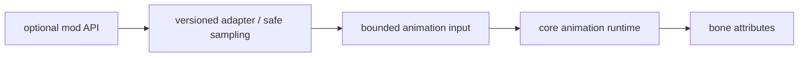

# 模组动画联动

目前已经交付了[统一 Molang 声明与受控上下文](../architecture/animation/molang-declarations.md)以及加载前类级接纳机制，覆盖了脚本层的状态桥接；但具体 adapter 的线程安全、玩法兼容、模型渲染衔接以及实机表现仍待逐一验收。主线代码中也仍保留着部分直接模组联动，大量目标模组尚未迁入新框架。本页定义后续适配边界以及宣称正式支持前的验收条件。

## 适配边界

每个 adapter 只负责把可选模组的状态转换为有界的动画输入——例如 Molang 查询值、控制器判断条件、标准化动作状态或渲染上下文提示。Adapter 不得自行维护动画状态机、篡改网络权威、持有渲染器资源，也不得把第三方模组的类型泄漏到核心动画或处理器接口中。

绑定在主线程或非线程安全的第三方 API，必须在安全阶段完成采样，再把不可变快照交给后台动画 worker。可选依赖应独立加载、先检版本并做好故障隔离；当目标模组缺失、版本不匹配或 adapter 抛出异常时，直接退回核心动画逻辑，不影响模型加载与基础渲染。

## 候选范围

后续适配按领域分为三类：战斗与武器、移动与载具、实体装备与渲染。接入优先级根据目标模组 API 的稳定性、玩家覆盖面以及对核心边界的侵入程度综合决定。

## 宣称支持的条件

- 明确列出支持的模组版本和游戏版本，缺少依赖时不触发类加载异常或注册失败；
- 本地玩家与远端实体使用一致的标准化动画语义，来自网络的输入仍须经过服务端校验；
- 异步动画路径不直接调用主线程限定 API，adapter 故障能够局部隔离；
- 完成核心动作、模型切换、重连、第一与第三人称以及相关渲染 pass 的实机功能与视觉验收；
- 将“只提供动画输入”的联动与“实际改动渲染层、骨骼附着或网络协议”的扩展分开评审。

尚未满足上述全部条件的模组，一律标记为未支持。
