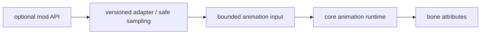

# 模组动画联动

## 现状

当前已交付[统一 Molang 声明与受控上下文](../architecture/animation/molang-declarations.md)及加载前类级接纳机制，覆盖脚本层状态桥接；主线代码中仍保留部分直接模组联动，多数目标模组尚未迁入新框架，已接线 adapter 的线程安全、玩法兼容与渲染衔接仍待逐一验收。

## 适配边界

每个 adapter 负责将可选模组状态转换为有界的动画输入（Molang 查询值、控制器条件、标准化动作状态或渲染上下文提示），与核心动画状态机、网络权威、渲染器资源及第三方类型解耦。

- **线程与采样隔离**：主线程限定或非线程安全的第三方 API 在安全阶段完成采样，以不可变快照交由后台动画 worker 消费。
- **版本门控与降级**：可选依赖独立加载并先校版本；模组缺失、版本不匹配或 adapter 异常时局部隔离并回退至核心动画逻辑，不影响模型加载与基础渲染。

## 演进思路与支持条件

后续适配按**战斗与武器、移动与载具、实体装备与渲染**三类推进，优先级依目标模组 API 稳定性、玩家覆盖面与侵入程度综合决定。仅“提供动画输入”的联动与“改动渲染层、骨骼附着或网络协议”的扩展分开评审。

某模组在满足以下条件后列入正式支持：

- 明确支持的模组版本与游戏版本，缺少依赖时不触发类加载异常或注册失败；
- 本地玩家与远端实体使用一致的标准化动画语义，来自网络的输入经服务端校验；
- 异步动画路径不直接调用主线程限定 API，adapter 故障可局部隔离；
- 完成核心动作、模型切换、重连、第一/第三人称及相关渲染 pass 的实机功能与视觉验收。
