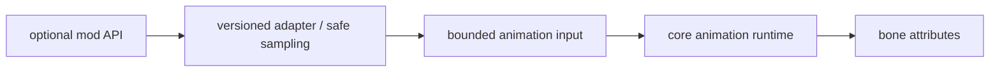

# 模组动画联动

当前已交付[统一 Molang 声明/受控 context](../architecture/animation/molang-declarations.md)及加载前类级接纳，覆盖脚本状态桥接；具体 adapter 的线程、玩法、模型/渲染与实机支持仍需验收。主线仍保留部分直接模组联动，大量目标未迁入。本页定义后续适配边界与正式支持的验收条件。

## 适配边界

每个 adapter 只负责把可选模组状态投影为有限的动画输入，例如 Molang query、controller predicate、标准化动作状态或 render-context hint。Adapter 不得拥有动画状态机、修改网络权威、持有 renderer 资源，也不得让模组类型泄漏到核心 animation / processor 接口。

主线程限定或非线程安全的 API 必须在安全阶段采样，再把不可变值交给动画 worker。可选依赖应独立加载、检测版本并隔离失败；缺少模组、版本不匹配或 adapter 异常时退回核心动画，不影响模型加载与基础渲染。

## 候选范围

覆盖面分为战斗与武器、移动与载具、实体/装备与渲染三类；接入顺序按 API 稳定性、用户覆盖面和对核心边界的侵入程度决定。

## 宣称支持的条件

- 明确支持的模组与游戏版本，缺少依赖时无 class-load 或注册失败；
- 本地与远端实体使用一致的标准化语义，网络输入仍经服务端验证；
- 异步动画路径不直接调用主线程限定 API，adapter 失败可隔离；
- 完成核心动作、模型切换、重连、第一/第三人称和相关 render pass 的实机功能与视觉测试；
- 将仅供输入的联动与真正改变渲染 layer、骨骼附着或协议的扩展分别评审。

未满足这些条件的具体模组应标记为未支持。
