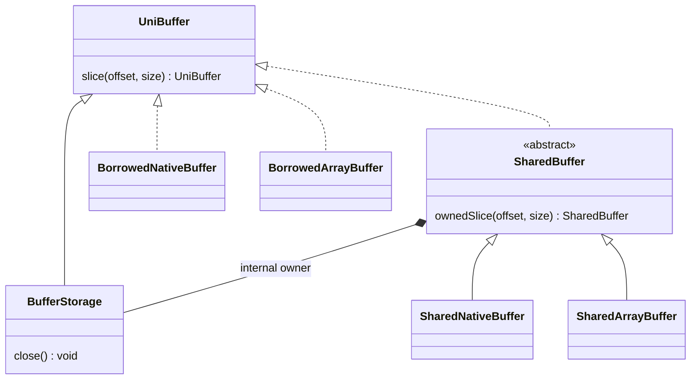

# 基建使用指南

本文提供可复用基建的使用决策与契约索引。格式、协议、业务生命周期和 native 内部实现仍以对应标准与架构页为准。

现有门面能够承担职责时，必须复用，不在业务包复制 helper 或建立平行抽象。契约不足时，优先扩展原门面；只有职责、生命周期或性能约束不同且无法合理扩展时，才新增机制，并说明不能复用的原因与维护成本。

`com.elfmcys.ysm.util` 是历史形成的工具集合，不表示其中所有类型都是通用基建。新代码只应把本文列出的入口及其链接到的领域门面视为首选能力。

## Java 类型命名

包名表达归属，类型名表达职责。内部类型不加 `Ysm` 前缀；仅在消除实际歧义时使用领域限定，例如 `MolangContext`、`ModelSoundId`。接口与实现均按职责命名，不用 `I`、`Impl` 或 `Production` 区分。

`State` 表示可变状态，`Binding` 表示绑定关系，`View` 表示访问视图，`Scope` 表示生命周期作用域，`Catalog` 表示目录。内建成员提供类使用 `<Domain>Builtins`，有状态组件使用 `<Domain>Component`；`Capabilities` 只表示能力集合或资格描述。事件处理器使用 `Handler`，事件载荷使用 `Event`。

`YsmExtension`、`YsmEventHandler`、`YsmEntityComponent` 保留前缀，明确第三方扩展的接入目标。产品入口和具体格式名也可保留产品名。Java 类型重命名不改变 Molang 名称、资源 ID 或协议标识；生成源码、反射名称和服务注册中的 Java 类型引用应同步更新。

## 主题索引

| 主题 | 内容 | 首选入口 |
|---|---|---|
| [Buffer 与所有权](#buffer-与所有权) | array/native bytes、切片、复制、映射与跨存储访问 | `UniBuffer`、`ArrayBuffer`、`NativeBuffer`、`UniBufferIO` |
| [生命周期与构造回滚](#生命周期与构造回滚) | Cleaner 默认回收、固定 owner 的及时关闭与构造回滚 | `CleanerUtil`、`try`-with-resources、`ScopeGuard`、`ResourceTransaction` |
| [JNI 与 native 能力](#jni-与-native-能力) | runtime 初始化、调用期借用、owning output 与 typed handle | `NativeLibUtil`、`NativeRuntime`、`BufferArgument`、`NativeObject` |
| [Protobuf 字节适配](#protobuf-字节适配) | QuickBuffers 序列化、array buffer source/sink 与只读比较 | `ProtoUtil`、`ProtoBytes` |
| [扩展兼容基建](#扩展兼容基建) | 编译期 checker 与运行时事件处理器注册 | `@YsmExtension`、`@YsmEventHandler` |
| [Molang 扩展接纳](#molang-扩展接纳) | 统一 view、普通效果申请与 defer payload | `MolangContextView<E>`、`MolangInputs`、`PreparedEffect`、`MolangEffect` |
| [并发与执行边界](#并发与执行边界) | owner、背压、shutdown 与宿主线程约束 | 领域 executor、`ThreadScheduling.entry`、Minecraft/Forge 调度入口 |
| [启动功能验证](tools/startup_observation/run_functional.py) | 隔离 Forge 世界中的真实消费与 required I/O 失败，保留输入身份、原始日志与独立断言 | `extract_inventory.py` 清点独立输入，`JfrStartupExtract.java` 提取原始 JFR；overlay 在隔离源码的 `ClientStartup` 安装；`REQUIRED_READY` 包含 Catalog activation 的短接纳，可与普通扫描重叠 |
| [第一人称验证输入](tools/first_person_observation/README.md) | 同源 raw/protobuf 几何、局部矩阵独立期望、动作和 workload 输入 | `generate_fixtures.py`；定向测试核对输入一致性与真实 JNI 接纳 |
| [持续性能基建](tools/benchmark/README.md) | 长期 JMH source set、真实 native 提取/输出工作量与独立 fork 对照 | `benchmarkClasses`、`benchmark`、`prepareBenchmark` |

表达式执行使用冻结的 `ExpressionBinding` 和 installation 缓存的 SubjectBinding；provider 使用声明 view，动作仍由固定入口许可约束。入口、factory 与结构授权见[Molang runtime](architecture/animation/implementation/molang-runtime.md#binding-与-invocation)。

## Buffer 与所有权

项目内部的连续 bytes 优先使用 `UniBuffer` 族。只有与要求特定 Java 表示的外部系统交互时，才在适配边界使用 `byte[]` 或 NIO `ByteBuffer`，不让这些表示替代项目内的 ownership 契约。

创建 buffer 时，Java 连续执行小块读写的场景倾向使用 `ArrayBuffer`，例如 Protobuf；大块读写或主要由 native 读写的场景倾向使用 `NativeBuffer`。这只是创建时的存储选择：已有 `UniBuffer` 如果满足消费方契约，应直接使用，不为符合倾向而额外复制和转换类型。

`UniBuffer` 最大容量为 256 MiB，只表达访问与范围，不提供关闭权。`NativeBuffer` 与 `ArrayBuffer` 区分访问表示；`BufferStorage`、`SharedBuffer` 与借用切片区分生命周期。

`BufferStorage` 由固定 owner 显式关闭，不注册 Cleaner，不维护引用计数或关闭状态。`SharedBuffer` 是封装 Cleaner 生命周期的抽象类。`SharedNativeBuffer` 与 `SharedArrayBuffer` 继承该类，只负责各自的访问表示和切片。来自同一 allocation 的共享视图持有共同的内部 owner；该 owner 注册一次 Cleaner，消费者只保留或撤销强引用。GC buffer 不提供 `close()` 或 `clean()`。选择 GC buffer 可避免跨消费者协调关闭；代价是物理回收可以滞后。



| 入口 | 契约 |
|---|---|
| `ArrayBuffer.allocate` / `NativeBuffer.allocate` | 创建 `ArrayStorage` / `NativeStorage`，固定 owner 负责显式关闭 |
| `NativeBuffer.mapFile` | 创建只读映射 Storage，固定 owner 关闭时解除映射 |
| `move` | 接管传入 backing；调用方移交后不得继续承担释放责任 |
| `borrow` / `slice(offset, size)` | 始终返回借用视图；没有关闭权，不延长来源规定的使用窗口 |
| `SharedBuffer.ownedSlice(offset, size)` | 返回保留共同 GC owner 的切片；不复制 bytes，不新增 Cleaner |
| `SharedNativeBuffer.adopt` / `SharedArrayBuffer.adopt` | 消费整个 Storage 的所有权；失败也负责回收，原 owner 不得再关闭或使用 Storage |
| `SharedNativeBuffer.allocate` / `SharedArrayBuffer.allocate` | 创建由 Cleaner 回收的 GC buffer |
| `SharedNativeBuffer.copyOf` / `SharedArrayBuffer.copyOf` | 将输入复制为独立 GC buffer；用于借用跨窗、表示转换或可变输入隔离 |
| `SharedBuffer.copyOf` | 保持输入存储表示，复制为独立 GC buffer |
| `share()` / `shareNative()` / `shareArray()` | 输入是匹配存储表示的 SharedBuffer 时返回自身；其他情况复制当前范围为 GC buffer。`share()` 保持原表示，不转移 Storage 关闭权，也不保证内容隔离 |
| `copy()` | 复制为独立 Storage，由接收方显式关闭或交给 GC wrapper 接管 |
| `copy(offset, size)` | 复制指定范围为独立 Storage，并在复制结束后 fence 原 owner |
| `copyNative()` / `copyArray()` | 复制为指定存储表示的独立 Storage |
| `nio()` / `array()` / `ptr()` | 只派生访问视图或地址，不延长 owner 生命周期 |
| `UniBufferIO.copy` / `equals` | 统一 array/native 组合并校验 range；不要在业务代码重复写分支和裸地址访问 |

`BorrowedNativeBuffer` 保存有界地址与 anchor；`BorrowedArrayBuffer` 保存数组范围与 anchor。Anchor 保留来源的存储或宿主引用，但不能阻止显式关闭、扩容、池归还或内容复用。从 GC buffer 借用时，anchor 只指向 Storage，不保留 GC owner；调用方应另行保活原 GC buffer。借用池化数组时，只保留数组不足以阻止归还池。借用切片复用同一个 anchor，不形成父切片链。

`slice()` 对 GC buffer 也只表达借用。需要在其他作用域保留时，已知 GC 来源可使用 `ownedSlice()`；其他来源应复制，或由固定 owner 覆盖整个使用期。Storage 的关闭是一次性契约；重复关闭、关闭后访问和并发 close/use 均由调用方避免，访问方法不检查关闭状态。

`@Owned`、`@Borrowed` 和 `@Aligned` 只表达审查契约，没有运行时 enforcement。接收 owning Storage 后，应明确固定 owner，或将整个 Storage 交给 GC wrapper；不向多个消费者分发关闭权。

从 owner 提取 `ByteBuffer`、array 或 raw pointer 后进入 JNI/Unsafe 时，必须在 `finally` 中对原 owner 调用 `Reference.reachabilityFence`。Fence 只保证同步调用期间可达，不解决并发 close/use。完整跨语言约束见 [JNI 与内存](architecture/native-runtime/implementation/jni-and-memory.md)。

完成且只读使用的 bytes 跨消费者交付时，优先返回 `SharedBuffer`。生产方将最终 Storage 直接交给 `adopt`，消费者保留同一 buffer；需要修改时先复制。领域对象的 `close()` 仍撤销资格、归还预算并清除自身引用，不撤销已交付的 bytes。可变构造与固定作用域 I/O 继续使用 Storage。

`Image.adopt` 接管 Storage，`Image.data()` 返回 GC buffer，`Image.share()` 共享同一 backing。`Image.close()` 只撤销当前 Image 的引用；其他共享 Image 和已交付的 GC buffer 继续有效。

## 生命周期与构造回滚

资源管理默认使用 Cleaner。GC 能根据 Java heap 占用和操作系统可用内存调整回收频率；后者覆盖 native allocation，因此 native memory 不因位于 Java heap 之外就要求手动关闭。当资源压力能由这些信号反映，且释放延迟不影响正确性时，允许物理释放自然滞后。

固定作用域的 buffer 使用前节的 Storage 契约。其他资源只有在 GC 无法感知资源容量，或正确性要求及时终结时才使用手动 `close()`，并且仍须先证明唯一 terminal owner。典型例外包括锁、文件句柄、profiler scope、GPU 等不由操作系统可用内存表示的资源，以及会影响 asset 传输会话取消的 lease。若需要及时释放却无法证明固定 owner，应先修正 ownership 设计，不能把 close 权分散给多个引用持有者。

| 入口 | 契约 |
|---|---|
| `try`-with-resources | 唯一 terminal owner 已确定且需要及时终结时使用；关闭顺序由声明逆序决定 |
| `com.elfmcys.ysm.util.Closeable` | 不声明 checked exception 的 `AutoCloseable`；适合项目内确定性关闭协议 |
| `ScopeGuard<T>` | 构造期间暂时持有一个固定 owner 的 `AutoCloseable`；失败时关闭，`release()` 后把所有权移交给长期 owner |
| `ResourceTransaction` | 构造多个固定 owner 资源时按取得顺序 `own()`；未 `commit()` 则逆序回滚，`commit()` 后整体移交 |
| `CleanerUtil` | owner 类型注册默认回收 action 的统一入口；业务调用点不直接操作 Cleaner |
| `NativeObject` | 通用 opaque native handle owner；`get()` 拒绝已关闭对象，Cleaner 与允许的显式关闭汇合到一次 destroy |

新交付的 raw opaque handle 使用 `NativeObject.adopt` 与接受其一次释放状态的 wrapper factory；factory 必须在取得 handle 前可用，完成构造前不暴露 owner。adoption 失败包含 wrapper 分配、构造和 Cleaner 注册，均回收到同一个 destroy 状态；后续载体构造失败使用已建立的 wrapper 关闭。直接调用接收 raw handle 的构造器不覆盖构造器执行前的对象分配失败。

Owning direct 输出使用 `NativeHeapBuffer.adopt`，只接收与 native allocator 配套的 base view，成功后交付 Storage；采用失败释放尚未交付的 allocation。不能用该入口采用任意 direct slice 或其他 allocator 的地址。需要 GC 生命周期时，再由 `SharedNativeBuffer.adopt` 消费 Storage；GC owner 构造或 Cleaner 注册失败也应回收。

`ResourceTransaction` 的 rollback 会抑制各资源的关闭异常，因此只适合“清理失败不能替代原始构造失败”的路径。关闭失败本身需要进入领域结果或诊断时，应由具体 owner 显式处理。

Cleaner action 及其参数不能强引用被注册对象，否则对象永远无法变为 phantom reachable。支持显式关闭的资源必须让 close 与 Cleaner 共享同一个原子 exactly-once 状态；线程亲和资源的 action 只排入所属线程，不能在 Cleaner 线程直接销毁宿主对象。模型资源的 owner 与清理责任见[所有权与生命周期](architecture/model-management/client-resources/implementation/resource-ownership.md)。

```java
try (var resources = new ResourceTransaction()) {
    var model = resources.own(loadModel());
    var texture = resources.own(loadTexture(model));
    var target = new RenderTarget(model, texture);
    resources.commit();
    return target;
}
```

`commit()` 只表示资源已被返回对象或其他明确 owner 采用；不能在没有后继 owner 的情况下用它跳过关闭。

## JNI 与 native 能力

生产启动通过 `NativeLibUtil.load()` 选择当前环境的库，再由 `NativeRuntime.load()` 查询 native ABI 符号并执行 JNI 注册。构建工具和测试复用后者。`NativeRuntime.initialize()` 是一次性配置协商：重复调用必须使用相同的 Java config。业务功能不得自行 `System.load`、重复初始化，或建立第二套可用性状态。

配置默认通过 `NativeRuntime.deviceQuality()` 消费一次设备分档。两个配置共享结果；native 不可用、入口缺失或未知返回均采用保守默认，不重新探测。跨语言编码与责任见[设备配置默认](architecture/native-runtime/implementation/runtime-capabilities.md#设备配置默认)。

`BufferArgument.packInput()` 把 `UniBuffer` 转成一次同步 JNI 调用使用的对象与 flags；它不创建持久 handle，也不延长 backing 生命周期。`unpackOutput()` 返回 owning Storage；接收方负责显式关闭或移交 GC wrapper。普通业务代码优先调用 typed native 门面，不直接操作 `BufferArgument`：

| 能力 | Java 门面 |
|---|---|
| hash 与压缩 | `Blake3`、`Zstd` |
| 图片 | `Image`、`ImageEncoder` |
| 归档 | `NativeArchive.open` |
| 烘焙与 CPU 渲染 | `NativeBakedModel`、`NativeModelState`、`NativeRenderer` |
| 历史格式导入 | `NativeLegacyImporter` |
| 音频规范化与增量解码 | `AudioNormalizer.normalize`、`OpusDecoder.create` |

现有门面缺少操作时，应先扩展对应能力门面和 native entry，不在业务类中新增旁路 `native` 方法。JNI 的 fallback 值必须由 Java wrapper 解释；false、null 或默认标量不能直接当作有效领域结果。能力分工和失败边界见 [Native 运行边界](architecture/native-runtime/implementation/runtime-capabilities.md)。

## Protobuf 字节适配

Java 内部共享 immutable generated message；跨 JNI、文件或自定义 frame 边界时才序列化为明确拥有的 bytes。Schema 与 wire 语义由[独立标准](standards/README.md)定义，以下入口只负责 Java 表示适配。

| 入口 | 契约 |
|---|---|
| `ProtoUtil.sink(ArrayBuffer)` | 在现有 array range 上建立 QuickBuffers sink；buffer 必须覆盖写入期且容量由调用方保证 |
| `ProtoUtil.source(UniBuffer)` | 直接借用 array/native range 建立 QuickBuffers source，不转换存储表示；调用方保持 owner 存活，并在解析结束的 `finally` 中对 owner 调用 `Reference.reachabilityFence` |
| `ProtoUtil.serializeToArray(message)` | 按精确 serialized size 创建独立 `byte[]` |
| `ProtoUtil.serializeToBuffer(message)` | 返回 owning `ArrayStorage`；写入失败会关闭构造中的固定 owner |
| `ProtoBytes.copy(ByteBuffer)` | 从当前 remaining range 复制，不推进原 buffer cursor |
| `ProtoBytes.equals(...)` | 比较当前 remaining range，不推进原 buffer cursor |

JNI 不暴露 QuickBuffers message、builder、parse cursor 或 allocator。需要 native 消费时，先用 `ProtoUtil` 得到 owning bytes，再按 `UniBuffer` 契约在同步调用期间借用。

## 扩展兼容基建

第三方模组引用 YSM 符号时，使用 `@YsmExtension` 声明兼容检查入口；需要自动注册 YSM 事件处理器时使用 `@YsmEventHandler`。同一个 YSM 主制品同时作为编译依赖和 `annotationProcessor`，由 `ExtensionCompatibilityProcessor` 生成不直接链接 YSM 的启动期 checker。

不要自行复制 checker 生成、Forge scan metadata 发现或先检查再加载的反射流程。接入方式、覆盖范围、状态语义和限制统一见[扩展模组兼容性检测](extension-compatibility.md)。这些注解当前不构成稳定公共 API 承诺。

## Molang 扩展接纳

公共 Molang 声明使用[共同签名与值契约](architecture/animation/molang-declarations.md)，builtin/API 共用 declaration 的规则与 emitter。统一公共 view 只提供 subject、只读轮输入和通用申请提交，不暴露 processor、batch 或执行控制。声明类在原领域 owner 上实现查询和动作准备；普通效果固定目标与不可变载荷，runtime 完成整轮裁决后按序提交。新增业务不扩展 context、中央 symbol 表或 typed command 分类。纯目标由声明元数据提供，只有内部可信来源可授权；消费者使用接纳后的声明集合。

安全发现、all-of 依赖、auto/manual 资格和类级冻结由[扩展接入](architecture/integration/implementation/extension-loading.md#扩展兼容检查与注册)拥有；对外 AP 打包与提交方式见[兼容检测](extension-compatibility.md#molang-声明)。不要新增手写 registry、缺席 placeholder、运行时 availability 重探测或按来源复制 ValueRecipe。
## 并发与执行边界

Java 侧没有可供所有业务共享的通用异步 runtime。新建异步机制时，executor 必须属于具体领域 owner，并明确队列容量或背压、任务取消、迟到结果失效和 shutdown 顺序。Minecraft client/render/server thread 的工作使用对应宿主调度入口，不能因为已有线程池而绕过 thread-affinity。

`ResponsiveExecutor` 是进程级固定容量 daemon pool，线程使用 `Thread.NORM_PRIORITY`。队列无界，pool 没有业务 shutdown 协议，不作为新增长期任务、资源 pipeline 或网络 worker 的默认入口。`maximumPoolSize()` 读取实际 pool 的最大容量；页面准备预算不复制 CPU 容量公式，也不读取活跃线程数。GUI 帧任务的独占执行与完整交接由页面和实体 owner 负责，pool 不接管资源生命周期。

`SpinLock` 只适合已证明竞争极短且不阻塞的临界区，不得跨 I/O、JNI、日志、事件派发或用户回调持有。

可恢复并发失败由领域 owner 形成 typed result、diagnostic 或 terminal state；不要新增全局 `Result`、重试器或后台队列来掩盖各领域不同的取消和发布语义。涉及跨模块协调机制时，先检查[复杂度地图](complexity-map/README.md)。

YSM 创建专属 Java platform thread 时，原 thread factory 用 `ThreadScheduling.entry(role, policy, body)` 包装整个 worker loop；替补 worker 复用同一入口。不包装提交到 Minecraft、Netty、common pool 或其他宿主 executor 的单项任务。门面只应用固定 OS 策略并记录有界诊断，不创建 executor、不接管业务生命周期，也不以 Java priority 作为失败 fallback。职责映射见[线程策略](architecture/runtime/implementation/execution.md#线程策略)，平台与失败契约见[Native 设计](architecture/native-runtime/overview.md#调用线程调度)。
